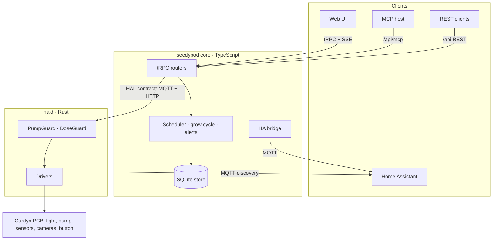

# Architecture

seedypod is two programs with a small, versioned contract between them.

## Two tiers

Exactly one long-lived process owns the hardware: **`hald`**, a Rust daemon. It enforces every safety rule internally, so no caller can bypass them. That design answers a specific bug history in the upstream Python project, where the pump's max-run cap lived in three places, scheduled watering skipped the low-water check, and each new process re-initialised PWM and glitched the light ([ADR 0004](/developers/adr/0004-two-tier-hal-core/)).

Everything else is **core**: the tRPC routers, REST, MCP, scheduling, the grow cycle, alerts, the camera recorder, the Home Assistant bridge and the web UI. Core talks only through the [HAL contract](/developers/hal-contract/) and never touches a pin.

## One control plane, several surfaces

Every capability is a tRPC procedure first ([ADR 0005](/developers/adr/0005-trpc/)). From there:

- **REST** is generated from the same procedures by `trpc-to-openapi` at `/api/*`, with the spec at `/api/openapi.json` ([reference](/developers/api/)).
- **MCP** at `/api/mcp` calls the tRPC caller, so tools inherit the same validation and the same safety path ([MCP for agents](/core/mcp/)).
- **Live updates** are a tRPC subscription over SSE (`events.onChange`), fed by an in-process event bus ([ADR 0015](/developers/adr/0015-event-bus/)). `GET /api/ws` streams the same events over a read-only WebSocket for clients that cannot speak tRPC.
- **Home Assistant** gets the physical device from `hald`'s own MQTT discovery, and the grow-cycle extras from core's bridge ([ADR 0013](/developers/adr/0013-ha-bridge/)).

## Core stack

Hono on Node serves tRPC, the REST facade, MCP and the built SPA from one `node server/dist/index.js`. The UI is Vite, React 19 and TanStack Router, styled with Tailwind 4 and sleepypod's design system ([ADR 0003](/developers/adr/0003-core-stack/), [ADR 0016](/developers/adr/0016-shared-design-language/)). Persistence goes through a `Store` interface: SQLite with drizzle on the unit, an in-memory store in tests and in the browser demo, held to one conformance suite ([ADR 0010](/developers/adr/0010-drizzle-sqlite-store/)).

The choice of Hono and Vite over sleepypod's Next.js is about memory: the Gardyn's Zero 2 W has 512 MB, and nothing in core needs server rendering.

## Deployment topologies

The contract is the same in every topology, so a unit moves between them by changing one URL.

| Topology    | Pi in the unit | hald | core                       | When                                            |
| ----------- | -------------- | ---- | -------------------------- | ----------------------------------------------- |
| A (default) | Zero 2 W       | yes  | yes                        | Whole stack inside the unit.                    |
| B           | Zero 2 W       | yes  | on a LAN box               | Several units under one core, or if A is tight. |
| C           | Pi 5           | yes  | yes, with on-device vision | When on-device computer vision is wanted.       |

The original Zero W can run `hald` (it is cross-built for armv6) but is not expected to host core.

## Demo mode

The [live demo](https://seedypod.vercel.app) is the same web UI built with `VITE_DEMO=1`: a tRPC link with in-browser handlers over TypeScript fakes of the HAL and seeded history. The simulator mirrors the pump guard's rules, so the demo never shows behaviour a real unit would refuse.
